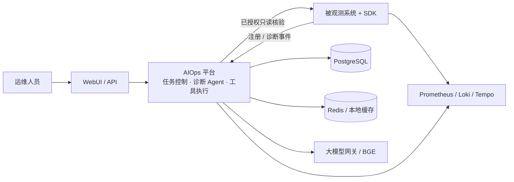

# AIOps · 对话式运维诊断顾问

这是一个面向多系统的 AIOps 诊断平台。它通过自然语言查询已注册系统的指标、日志、链路和 SDK 诊断记录，帮助运维人员回答：**发生了什么、可能为什么、还缺什么证据、应该怎样处理。**

平台支持多轮排查、证据回查、知识检索、外部告警和受控的主动核验。当前输出诊断与处置建议，默认不代替用户执行业务修复。

## 主要能力

| 场景 | 能力 |
|---|---|
| 系统巡检与故障排查 | 查询指标、日志、链路与诊断事件，区分已观测事实、候选原因与证据缺口 |
| 连续多轮协作 | 围绕同一问题补充证据、比较候选原因，并恢复历史会话 |
| 处置建议 | 给出前置条件、风险、回退和验收方式，避免将未核验推测写成定论 |
| 知识问答 | 检索已生效知识，生成带引用的回答 |
| 告警协作 | 接收 Webhook 告警，将选中告警引入诊断会话 |
| 多系统隔离 | 按被观测系统、服务、环境、集群和时间窗限定查询范围 |

## 架构



SDK 随被观测应用部署，AIOps 平台独立部署。PostgreSQL 是任务、历史、事故、告警和知识的权威存储；Redis 和本地缓存仅用于加速。SDK 注册成功只代表身份绑定完成，实际采集仍需要通过业务请求验证。

## 仓库中的三个被观测样例

这些目录是为了演示接入、采集和诊断，**不是 AIOps 平台本身的业务服务，也不包含真实生产数据**。

| 样例 | 位置 | 用途 |
|---|---|---|
| Python 交易链路 | `src/observed/biz` 及 `gateway` / `order` / `inventory` / `payment` | 一个由四个微服务组成的被观测系统，用于演示跨服务指标、日志和链路 |
| Python 诊断实验室 | `src/observed/diagnostic_lab` | 隔离的可控异常样例，用于展示诊断数据接入 |
| Spring Boot 商品服务 | `src/observed/springboot-example` | Java 应用与 Java SDK 的接入样例，默认使用内存 H2 数据库 |

三个样例的默认身份和凭据都是本地开发配置。部署到共享或生产环境前，必须重新签发接入凭据并收紧允许的 origin、环境和服务范围。

## 目录结构

| 路径 | 内容 |
|---|---|
| `src/agent` | AIOps 平台 API、诊断编排、知识、告警、任务与历史 |
| `src/sdk` | Python 采集 SDK |
| `src/sdk-java` | Java 采集 SDK |
| `src/diagnostics` | 共享诊断事件契约 |
| `src/observed` | 三个被观测演示系统 |
| `src/webui` | 运维工作台 |
| `deploy` | PostgreSQL、Redis、Prometheus、Loki、Tempo 等基础设施配置 |
| `tools` | 导入、部署准备和运维工具 |

## 快速开始

需要 Python 3.11+（建议 3.12）、PowerShell 和 Docker Desktop/Compose。Spring Boot 样例另需 JDK 17 与 Maven。

1. 创建虚拟环境并安装依赖。

```powershell
py -3.12 -m venv .venv
.\.venv\Scripts\python.exe -m pip install --upgrade pip
.\.venv\Scripts\python.exe -m pip install -r requirements.txt -r requirements-services.txt -e .
```

2. 生成本地配置。不要把复制后的 `.env` 提交到仓库。

```powershell
if (-not (Test-Path .env)) { Copy-Item .env.example .env }
if (-not (Test-Path deploy/.env)) { Copy-Item deploy/.env.example deploy/.env }
```

在 `.env` 中配置 PostgreSQL、Redis、观测数据源以及你使用的大模型网关。`AIOPS_LLM_API_KEY`、平台 Token 和 SDK 接入凭据只应通过本地环境变量或密钥管理系统注入。

3. 启动基础设施与平台。

```powershell
.\run.ps1 infra-up
.\run.ps1 infra-ps
.\run.ps1 agent-up --port 8020
```

平台启动后，访问 `http://127.0.0.1:8020/health`，再打开 `http://127.0.0.1:8020/webui/`。

4. 可选：在另一个终端启动 Python 交易链路样例。

```powershell
.\run.ps1 business-up
```

启动样例不等于已验证采集。请在发起一次受控业务请求后，分别核对系统注册、SDK 诊断事件以及指标、日志和链路数据。

## 配置与安全

- `.env.example` 和 `deploy/.env.example` 只提供字段样例；真实密钥、Token、证书、数据库备份和运行日志均不应入库。
- 主动 HTTP 核验只应访问已登记且已授权的接口；写操作、负载上限与重试策略必须在服务端继续校验。
- 外部提供的日志、告警和文档都应视为不可信输入，不能将其内容当作系统指令执行。
- 这个公开版仓库仅保留本 README；本地任务、规范、验收报告、测试目录与对话历史已通过 `.gitignore` 排除。

## 能力边界

- 诊断结论依赖已接入的数据源；没有记录、取数失败和视角覆盖不足是三种不同状态。
- 候选原因的置信等级不是经校准的统计概率；证据不足时应保留未知。
- 平台默认提供建议与受控核验，不将自动诊断等同于自动修复。
